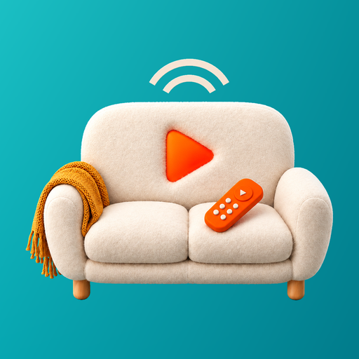

# BingeMote

A couch remote for VLC on your Windows PC, with a movie browser and a mouse-and-keyboard mode.

## Install

1. Download the Android APK and Windows helper from the project's GitHub Releases page.
2. Run the helper on your PC. If SmartScreen warns, choose More info, then Run anyway.
3. Complete the one-time Windows permission prompt for the helper's Private-network firewall rules and HTTP listener.
4. Open the Android app and follow setup: find the PC, enter its pairing code, then configure VLC's web interface.

Android 12+ and Windows x64. Keep both devices on the same trusted private network.

## Controls

- Play/pause, fullscreen, subtitles, volume and adjustable skip buttons.
- Hold the seek bar to unlock seeking. Tap the volume percentage to mute.
- Movies: arrows select, OK opens; phone volume keys move the highlight.
- Mouse: touchpad, click buttons, scroll strip, pinch zoom and keyboard.
- The app offers updates when it opens. Android confirms each installation.

## Network security

The helper requires pairing and accepts private-network addresses only. Traffic is unencrypted HTTP, including typed text and the token. Use only on a trusted network. Do not forward these ports to the internet.

Uninstalling the helper removes the program and its start-with-Windows entry. The one-time firewall rule and HTTP-listener permission stay behind (removing them needs administrator rights; they are inert without the helper). To remove them, run as administrator: `netsh advfirewall firewall delete rule name="BingeMote Helper"` and `netsh http delete urlacl url=http://+:8488/`.

More setup, build and protocol details are in [docs/details.md](docs/details.md).
