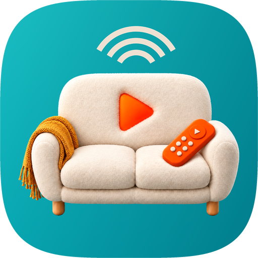

# BingeMote

A full-featured remote for VLC on your PC. Allows full control of starting and controlling VLC remotely, such as while sitting on the couch. Includes full mouse and keyboard support.

## Install

1. Download the Android APK and the PC installer from [Releases](https://github.com/MtndaleRedneck/BingeMote/releases).
2. Run the installer on the PC. If SmartScreen warns, choose More info, then Run anyway.
3. Open the phone app and follow setup: find the PC, enter its pairing code, set up VLC.

Keep both devices on the same trusted home network; traffic is not encrypted, so never forward its ports to the internet.

Controls, security, uninstall, and build details are in [docs/details.md](docs/details.md).

Not affiliated with VideoLAN. VLC is a trademark of VideoLAN.
